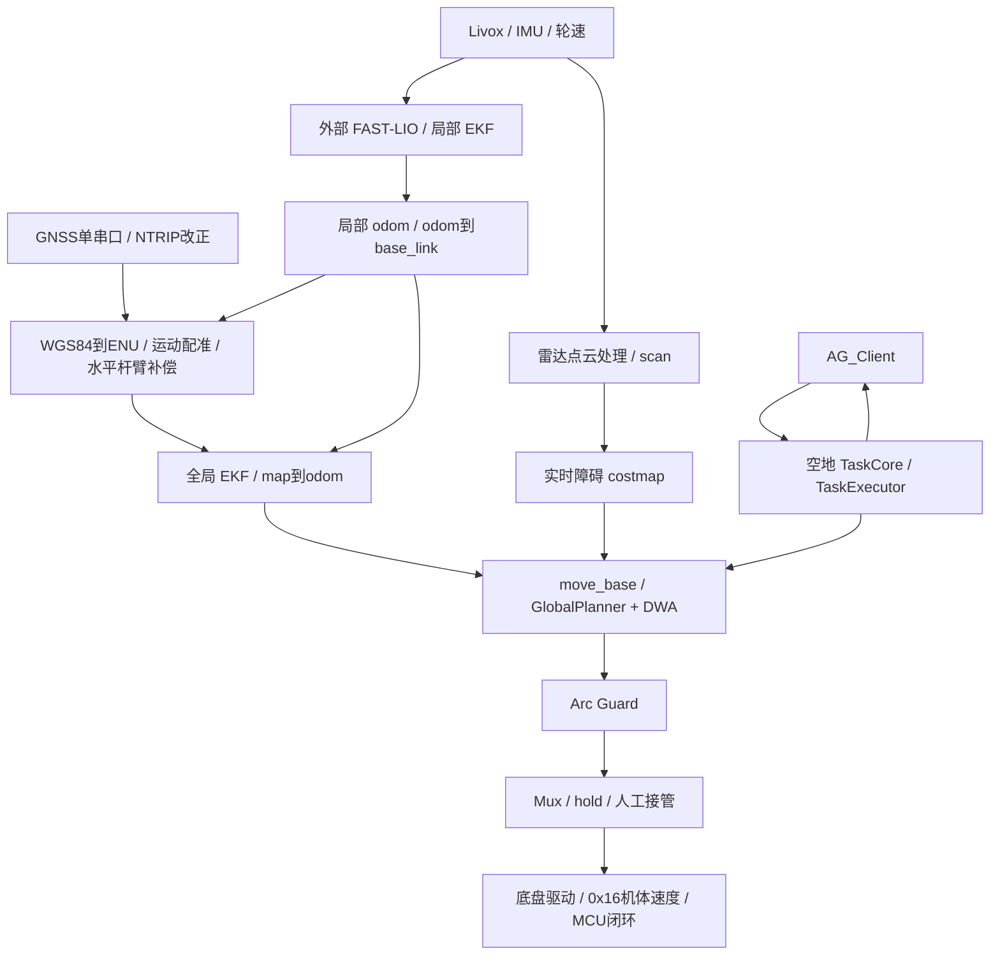

# 小车系统架构与适配结论

基线：用户提供的 `Online_Navigation_with_RTK.zip`，2026-11-17 静态核查。ZIP SHA256：`9be44706996783627dcc7f3e5e9c1cae6087202e0317266ba1fa7bb2cc7e4c76`。

这是源码/配置架构，不代表已连接车端核对进程、install、MCU 或实车行为。分析只读取源码，未启动其入口、驱动、release 或运动任务。

## 默认工作链

| 层 | 已核实的默认配置 | 车端源码依据 |
| --- | --- | --- |
| 启动 | sensors、driver、nav、tasks 分开；tasks 只添加任务节点 | `run.sh`；`ugv_bringup/launch/slicer_air_ground.launch` |
| 局部定位 | 复用兄弟 NoRTK 工程的 `slicer_bringup`；本工程声明局部 EKF 独占 `odom→base_link` | `slicer_sensors.launch`；`tools/slicer_shell.sh`；`global_ekf.yaml` |
| 地理定位 | GNSS fix/quality 配对，WGS84→ENU，运动配准，一次水平天线杆臂补偿；全局 EKF 20 Hz / 2D，融合局部 twist 与 RTK XY，独占 `map→odom` | `gnss_global.py`；`ugv_bringup/config/global_ekf.yaml` |
| 导航 | geographic=true、mapping=false、depth=false；GlobalPlanner+DWA，上限 0.4 m/s、0.25 rad/s，只前进，无自动 recovery 旋转 | `slicer_field_navigation.launch`；`move_base.yaml`；`dwa.yaml` |
| 地图 | map 下固定 40×40 m、5 cm 全局障碍栅格，范围 `[-20,20)²`；odom 下 4×4 m 滚动局部栅格；不是持久化 SLAM 地图 | `outdoor_map.yaml`；`costmaps.yaml` |
| 控制 | `/cmd_vel/nav_raw`→Guard→`/cmd_vel/nav`→Mux→`/cmd_vel`→driver；Guard 检查 LIO/costmap/TF 新鲜度及 footprint 扫掠；Mux 启动 held | `arc_velocity_guard.py`；`velocity_mux.py`；`slicer_manual.py` |
| 底盘 | body_speed 0x16，MCU 执行机体速度转换；命令/遥测/反馈超时保护，无 PWM fallback | `slicer_driver_body_speed.yaml`；`c30d_driver_node.py` |
| 任务 | 唯一 Action 执行出口；五类命令；换段等待取消确认；最终 Action+停车+地理复核；状态 5 Hz，worker 约20 Hz | `air_ground_core.py`；`air_ground_executor.py`；`air_ground_node.py` |

表中未带目录的配置默认位于 `src/ugv_bringup/config/`，任务脚本位于 `src/ugv_navigation/scripts/`，控制脚本位于 `src/ugv_slicer_control/scripts/`。ZIP 未含完整兄弟 NoRTK 源码，因此局部 EKF 的完整融合矩阵、底层雷达处理实现及 MCU 固件不能独立确认。

**两个容易误解的行为：** 已注册后 GNSS 状态 `degraded` 可以通过当前执行健康检查，并非 RTK 丢失立即停车（`geographic_goal_core.py:29`）；电台断线也不自动取消最后已受理任务。终点地理复核则要求 ready、合格 RTK、停车窗口及残差通过。

## 本客户端已做的适配

1. 直接调用这份车端的 `capture_target`、wire、CLI 和 TaskCore 做离线对照：根层采点文件可读，请求保存文件可双向互换，五类命令及重复请求语义一致；不再将采点格式标为未知。
2. `CANCELING` 时本地拒绝非 SET 新命令，符合车端状态机，避免发送必然被拒绝的请求；精确 replay 仍交给车端去重。
3. 新 SET/REPLACE/RESUME 发布前检查执行快照年龄、启动检查、取消屏障及 WGS84/base_link_horizontal 语义。默认执行快照上限2秒，可通过 `--execution-max-age` 配置；这不替代车端定位/控制检查。PAUSE/CANCEL 不增加这些执行健康门禁，精确 replay 保留原语义。
4. `health()` 区分反馈新鲜和执行推进新鲜；`task_status(task_id)` 仅用对应任务的最终结果，核对 Action=3、停车、合格RTK、残差及同一静止窗口。其他任务遗留 arrival 不会误报完成。
5. replay 不会因车端持续发布的同一旧 `transport_error` 提前结束；等待本次新增错误或正式回执，不自动重发。

对外仍只使用两个正式 topic，不跨电台接入 `/tf`、Action、costmap 或速度链；客户端不会自行解除 hold。

## 建议小车侧修改的优先级

以下为建议，未修改车端源码，也未部署。

1. **先核实 MCU 与上位机几何一致性。** README 第31行记录 MCU 前馈轮距/轴距仍为 0.15/0.17 m，上位机配置为 0.179/0.13 m；0x16 的转换在 MCU 侧，仅改 ROS YAML 不会统一底层模型。建议增加固件版本/有效几何回报并在启动核对，实机复核后再决定是否更新固件，先不靠 DWA 调参掩盖偏差。
2. **车端受理前校验固定地图边界。** `RosNavigation.validate_route()` 当前转换整批点，但未检验固定 global costmap 的范围。建议按实际地图元数据原子校验终点与途经点，越界给结构化拒绝；飞机端不要硬编码 ±20 m。
3. **明确定位退化和栅格失配策略。** 已注册 degraded 仍可继续；map→odom 累计平移纠偏超过0.5 m目前只标记 `costmap_rebuild_recommended`（`gnss_global.py:170`）。建议设置可配置退化时间/里程预算，并对旧障碍栅格失配增加 hold→重建→明确恢复流程。具体阈值须结合场地复核，不直接在客户端推断或自动release。
4. **在正式 state 汇总精简 readiness/capabilities。** 将注册/代次、定位可用性、Action状态、Mux hold来源、Guard原因、有效地图边界汇总，减少试发命令与额外topic同步；worker调用 `control.py` 最长等待12秒，建议进一步公开阻塞阶段或改异步等待。电台负载先实测，再考虑将静态软件指纹低频发送，保持V1兼容。
5. **固定可复现部署与时间基准。** 记录外部NoRTK/Hardware版本、镜像digest、生成参数hash及source/install差异；当前GNSS时间为主机接收时刻，若提高动态绝对精度，优先核实测量历元、串口延迟和PPS，并实测安装几何。不要把同源RTK复核当独立测量真值。
